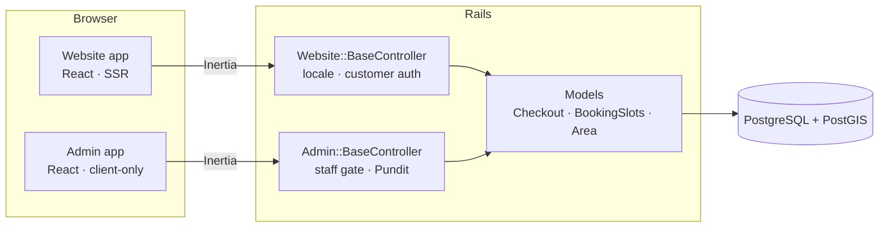

# Auto Atelier: car wash booking platform

A full-stack booking platform for a mobile car wash business. Customers pick a service, pin their location on a map and book a time slot. Staff run the business from a dashboard with role-based permissions. The public website is bilingual (English and Arabic, with full right-to-left layout), server-rendered, and its content is managed from the dashboard.

**Rails 8.1 · React 19 · TypeScript · Inertia.js · PostgreSQL + PostGIS · Tailwind CSS · shadcn/ui · RSpec · Vitest**

## Live demo

| | |
|---|---|
| **Website** | [autoatelier.erp-eg.com](https://autoatelier.erp-eg.com) · Arabic: [autoatelier.erp-eg.com/ar](https://autoatelier.erp-eg.com/ar) |
| **Staff dashboard** | [autoatelier.erp-eg.com/admin/sign_in](https://autoatelier.erp-eg.com/admin/sign_in) |
| **Dashboard login** | `reviewer@autoatelier.erp-eg.com` / `AutoAtelier-Demo-2026` (view-only: every screen, no changes) |

**Try it:** create an account on the website and book a wash, then sign in to the dashboard and find your booking. Sign-up is open, and the dashboard sign-in page has a one-click demo login. This is a demo, so please use a made-up email and phone number.

<!--
## Screenshots

| Website | Dashboard |
|---|---|
|  |  |
|  |  |
|  |  |
-->

## Features

### Public website

- **Service catalog**: categories, services with sale prices, and add-on extras, with filtering and pagination.
- **Booking checkout**: choose a car, pick a location on a map or use a saved address, choose a time slot and add extras. The server checks that the location falls inside a service area before accepting the booking.
- **Customer account**: sign up and sign in, password reset, saved cars and addresses, booking history, and account deactivation.
- **English and Arabic**: English at `/services`, Arabic at `/ar/services`, with right-to-left layout, translated server messages, and dates and money formatted in the business time zone.
- **CMS-driven pages**: home, about and other pages are built from reusable components, alongside a blog, FAQs, a contact form, and an editable header and footer.
- **SEO and accessibility**: server-side rendering, per-page meta tags, `sitemap.xml`, `robots.txt` and branded error pages. Browser tests run axe-core accessibility checks in both languages.

### Staff dashboard

- **Operations**: bookings (status, payment status, employee assignment, rescheduling), customers with lifetime value, cars and payment transactions.
- **Catalog**: service categories, services, extras and memberships.
- **Coverage**: cities and service areas drawn as polygons on a map.
- **Website content**: pages, a component builder, blog posts, FAQs, header navigation, footer and contact messages.
- **Access control**: administrators, field employees, and roles built from a catalog of `resource.action` permissions.
- **Dashboard**: revenue trend, booking status breakdown and operational stats.

## Architecture



One Rails application serves **two separate Inertia/React apps**: the public website (server-rendered) and the staff dashboard (client-only, with its own layout and login). They share a domain-free layer of UI primitives, hooks and utilities.

```
app/javascript/
├── entrypoints/   website.tsx (SSR) · admin.tsx (client-only)
├── website/       pages · layouts · components · features/<feature>
├── admin/         pages · layouts · components · features/<feature>
├── shared/        shadcn/ui primitives, generic hooks and utilities
└── routes/        generated from config/routes.rb
```

`website/` and `admin/` cannot import each other, and `shared/` cannot import either app. ESLint enforces these boundaries, so `npm run lint` fails on a violation.

## Design decisions

**Business rules live in the domain layer, not controllers.** `Checkout` is a form object that holds every booking rule: the car must belong to the customer, the location must be covered, the slot must be valid, and the phone number is required on first booking. It creates the booking, its items, address snapshot and pending payment in one transaction. Prices and coverage always come from the database, never from the browser.

**Service areas are geographic polygons.** Areas are stored in PostGIS with a spatial index, and checkout finds the area that contains the customer's pin. The booking keeps a snapshot of the address and area name, so later edits to areas or saved addresses don't rewrite booking history.

**Translations are separate tables, not columns.** Every translatable model has a `<Model>Translation` table keyed by a `Language` record (for example `ServiceTranslation`). Adding a language is a data change, not a migration. Missing translations fall back to English.

**Arabic routing without duplicating routes.** A small Rack middleware (`LocalePrefix`) moves the `/ar` prefix into `SCRIPT_NAME`. Every Rails route, URL helper and redirect works unchanged and keeps the visitor's language. On the client, the generated route helpers pick up the same prefix.

**Permissions are data, and admins start with none.** Admins get access only through roles, and roles hold permissions from a fixed catalog (`Permission::CATALOG`). Every admin action is authorized server-side with Pundit (`verify_authorized` on every controller). The permission list sent to React only decides what the UI shows.

**Type-safe routing end to end.** TypeScript route helpers are generated from `config/routes.rb` by [typelizer](https://github.com/skryukov/typelizer). CI regenerates them and fails if they are out of date, so a renamed route breaks the type check instead of production.

**Schema-driven page builder.** A component defines its fields (text, rich text, image, repeater…) and marks which ones are translatable. Page sections store shared values once and translated text per language. Repeater items are joined across languages by a stable id, so every language shows the same items in the same order.

**Hand-rolled authentication.** Authentication uses `has_secure_password` and database-backed sessions in a signed cookie, not Devise. Sessions have an idle timeout, changing a password signs out other devices, and sign-in, sign-up, password reset and the contact form are rate limited. Customer accounts are deactivated rather than deleted, so bookings and payments stay intact.

## Scope and known limitations

This is a portfolio project, and some parts are intentionally simplified:

- **Payment is cash on arrival.** Bookings start unpaid with a pending cash transaction. `PaymentMethod` and `PaymentTransaction` are modeled so a gateway can be added later.
- **Time slots have no capacity limit.** Any listed hourly slot within opening hours can be booked.
- **No email delivery is configured.** The password reset mailer exists, but SMTP is not set up.
- **Memberships and packages are managed in the dashboard only.** Customers cannot purchase them on the website yet.

## Testing and CI

`bin/ci` runs the full pipeline locally, and GitHub Actions runs the same steps:

| Check | Tool |
|---|---|
| Ruby style | RuboCop (Rails Omakase) |
| JS lint, formatting, types | ESLint, Prettier, `tsc` |
| Frontend unit and component tests | Vitest + Testing Library |
| Arabic strings complete, placeholders match | `npm run i18n:check` |
| Generated route types are fresh | typelizer + `git diff` |
| Security | Brakeman, bundler-audit, `npm audit` |
| Model, request and authorization specs | RSpec |
| Browser specs: booking flow, navigation, RTL, mobile, accessibility | RSpec system specs, headless Chrome, axe-core |
| Seeds load cleanly, with and without demo data | `db:seed:replant`, `SEED_DEMO=1 db:seed:replant` |

## Running locally

**Requirements:** Ruby 4.0 (`.ruby-version`), Node 22 (`.node-version`), and PostgreSQL with the **PostGIS** extension (for example `postgresql-16-postgis-3` on Ubuntu). Your system user needs a Postgres role:

```bash
sudo -u postgres createuser --superuser "$USER"
```

```bash
bin/setup --skip-server   # install gems and npm packages, create, migrate and seed the database
bin/dev                   # Rails on :3000 + Vite dev server
```

In development the seeds load demo data (`db/seeds/demo.rb`): a catalog with photos, service areas, customers, staff, bookings and contact messages. Every demo account uses the password `password123456`:

| Where | Account | Access |
|---|---|---|
| [localhost:3000/admin/sign_in](http://localhost:3000/admin/sign_in) | `admin@example.com` | Super admin (every permission) |
| | `sara.manager@example.com` | Operations Manager role |
| | `omar.support@example.com` | Support Agent role |
| [localhost:3000/sign_in](http://localhost:3000/sign_in) | `mona.ibrahim@example.com` | Customer with saved cars, addresses and bookings |

### Demo data in other environments

Seeding a server (`bin/rails db:seed`) always creates the base content: languages, permissions, the Super Admin role, pages, header and footer, FAQs, blog posts and payment methods. Two optional pieces are controlled by environment variables:

| Variable | Effect |
|---|---|
| `ADMIN_EMAIL` + `ADMIN_PASSWORD` | Creates a Super Admin with these credentials (set both or neither). An existing account's password is never changed. |
| `SEED_DEMO=1` | Also loads the demo data. The demo staff and customers get a random password that nobody knows, or `DEMO_PASSWORD` if you set it. The development password is never used outside development. |
| `DEMO_LOGIN_EMAIL` + `DEMO_LOGIN_PASSWORD` | Shows these credentials, with a one-click sign-in, on `/admin/sign_in`. Use them for a public portfolio deploy, for an existing admin with a view-only role. Seeds don't create that account. |

The seeds are idempotent, so running them again only fills in what is missing. Photo sources and licenses are in `db/seeds/images/CREDITS.md`.

### Common commands

```bash
bin/ci                                  # full pipeline (run before pushing)
bin/rspec                               # Ruby specs
npm test                                # Vitest
npm run lint && npm run check           # ESLint + TypeScript
bin/rails typelizer:generate:refresh    # regenerate app/javascript/routes after changing routes
```

## Credits

Started from the [Inertia Rails React Starter Kit](https://github.com/inertia-rails/react-starter-kit) by Evil Martians (MIT License, see `LICENSE`).
